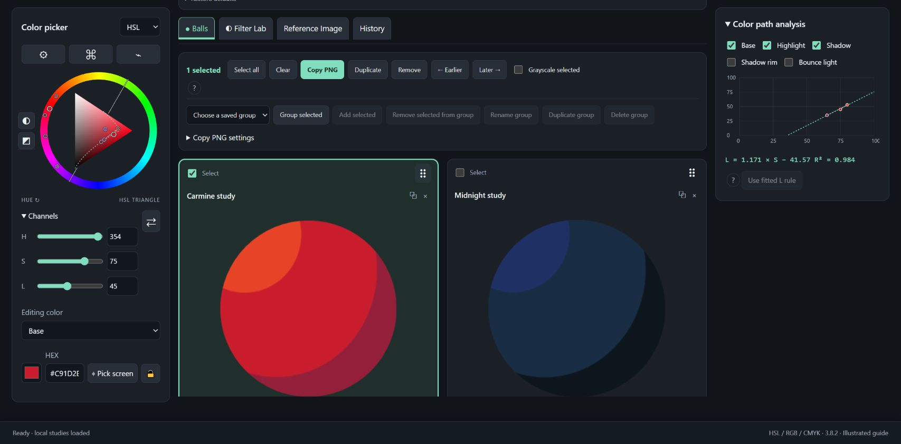
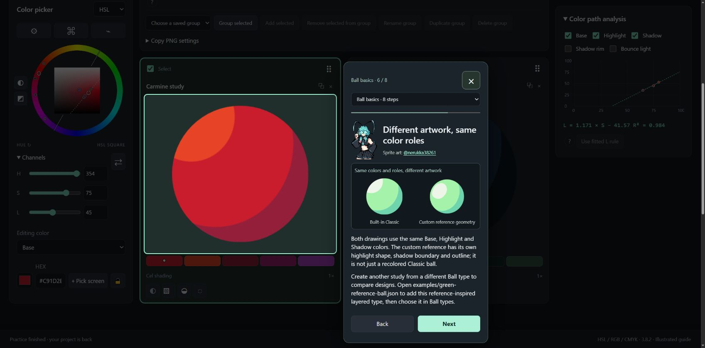
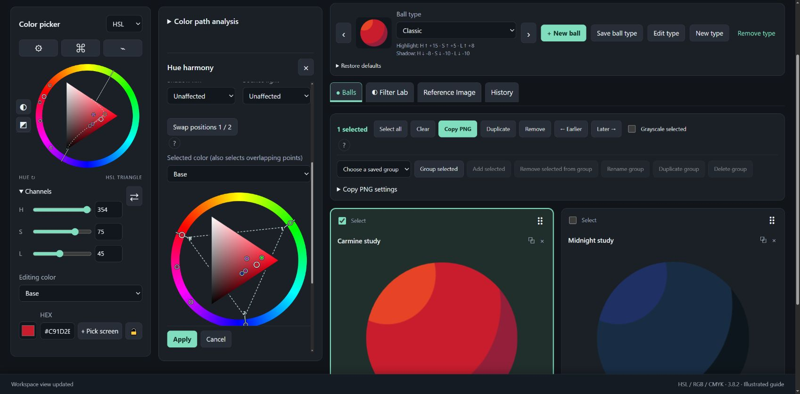
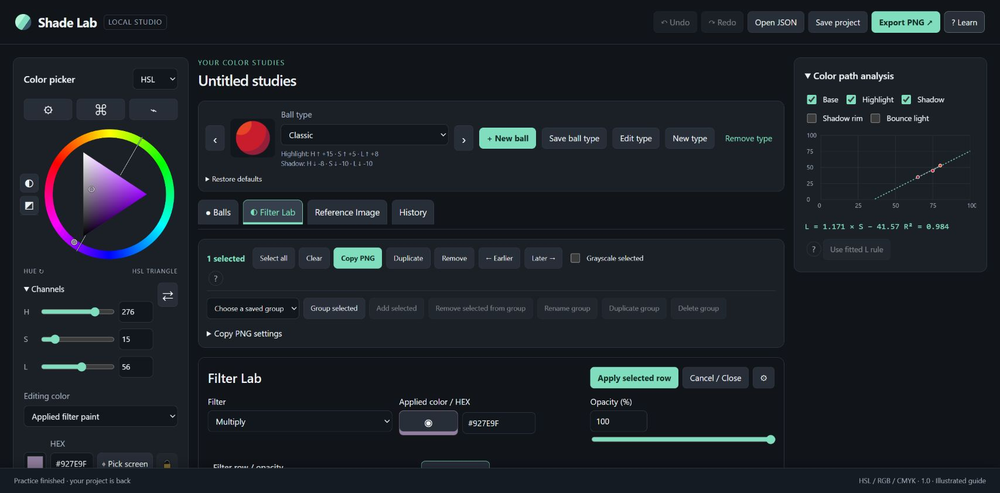
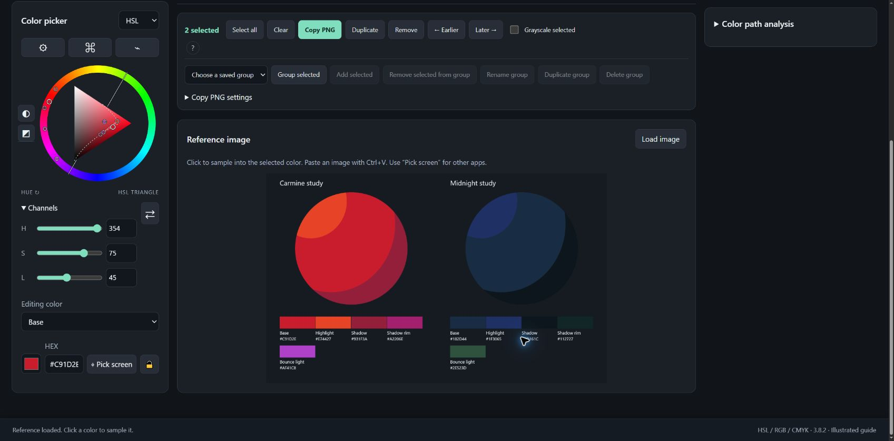
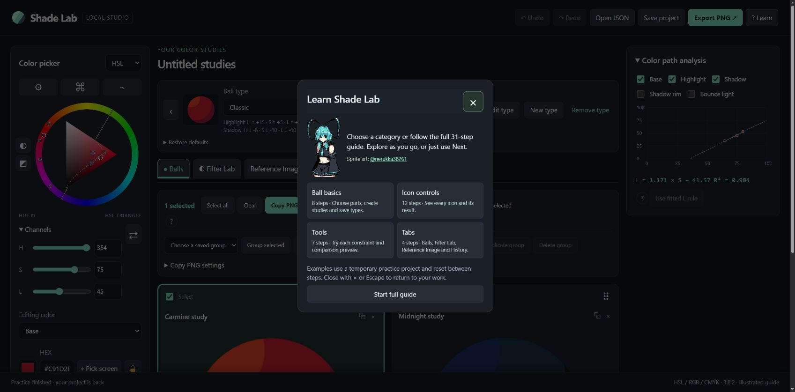
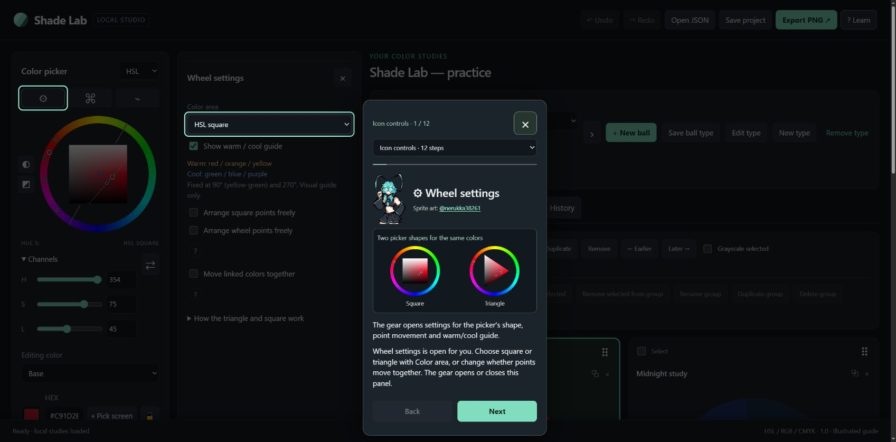

# Shade Lab

An offline color-study app for artists. Build shading palettes on a ball, compare color relationships, and try filters before taking the colors back to your artwork. Open one HTML file in your browser—no account or installation required.

**[Download Shade Lab 3.8.2](https://github.com/Y1-studio/Shade-Lab/releases/tag/v3.8.2)** · [User guide](HTML_GUIDE.md) · [Formula guide](AI_FORMULA_GUIDE.md)



## Start using it

1. Download **Shade-Lab-HTML-v3.8.2.zip** from the release and extract it.
2. Open **Shade Lab.html** in your desktop browser.
3. Click a colored part of a ball to select what you edit. Change its color with the wheel, sliders or HEX field; linked shading colors follow their recipes. **? Learn** introduces the app in short illustrated sections.

The app works offline. **User Guide.html** is included in the download.

## Features

- **Ball studies and shading recipes:** edit Base, Highlight, Shadow and extra regions; adjust shading strength and soft blending. Click the artwork or its swatches to choose the affected region.
- **Your own ball designs:** build custom types from transparent PNG masks and overlays, save reusable types in the Ball types library, and compare them with built-in designs. A layered green example is included.
- **Color controls:** hue wheel with linked points, square or triangle picker, HSL/RGB/approximate CMYK channels, grayscale checks, color-picking locks and screen sampling where supported.
- **Wheel and surface tools:** hue harmonies, hue limits with separate wheel/square locks, allowed color areas, line guides and selected-ball comparisons. Preview tool changes before applying them.
- **Filter Lab:** try Multiply, Screen, Overlay and other blend modes with paint, opacity and split before/after previews; apply the chosen result to selected studies.
- **Reference, history and export:** sample from a reference image, reuse committed colors, group studies, copy/export PNGs, and save editable JSON projects and types.
- **Illustrated starter guide:** explore Ball basics, Icon controls, Tools and Tabs separately. Each step explains what a control is and how to use it, with a picture. Practice is optional; × or Escape returns to your work.

## See it in use

### Custom ball designs

The same colors can use different artwork and region shapes. The guide breaks the green example into editable masks and a fixed outline, then compares it with Classic.



### Tools and filters

Tools keep their own previews and Apply/Cancel controls. Filter Lab shows the original and filtered colors together.

| Hue harmony | Filter Lab |
| --- | --- |
|  |  |

### Reference image

Load or paste an image, then click it to sample into the selected color. The History tab keeps completed color choices for reuse.



### Learn by section

Choose a category on the opening menu. The glasses guide accompanies the illustrated lessons; Next works without completing exercises or creating a ball.

| Choose a section | Follow a short visual lesson |
| --- | --- |
|  |  |

## Saving and updating

Studies and reusable ball types are stored in this browser on this device. **Save project** downloads an independent editable JSON backup; **Open JSON** imports it again. Keep downloaded backups before changing browsers, clearing browser data, moving the app or updating. PNG exports are images; JSON preserves editable studies.

To update, extract the new release into a separate folder, open its HTML file and import your saved JSON if needed. No cloud account or automatic synchronization is involved.

## Source and building

The current HTML app source, add-ons, examples and tests are included. The portable download contains the ready-to-open app and guides; GitHub's source archives are for development.

With Node.js 22 or newer:

```sh
npm ci
npm run build:html
npm test
```

`web/` contains the base app; `addons/` contains feature packages registered in `addons/registry.json`. `build-html.cjs` generates the standalone app and browser-readable guides. See [add-on development](addons/README.md) and the [release checks](HTML_VALIDATION.md). The build itself does not need a server. Source and portable checks can also be run with the commands in each package's README.

## Notes and credits

Desktop Chromium browsers are the verified target. Screen picking depends on browser support. CMYK is an approximate screen conversion, not a print profile; Add (Glow) in Filter Lab is experimental.

**Tutorial sprite art: [@nerukka38261](https://x.com/nerukka38261).** The original transparent regular and glasses poses are embedded in the offline app. See [third-party credits](THIRD_PARTY_NOTICES.md).

No project-wide source license has been selected. Third-party artwork and dependencies retain their own terms.
